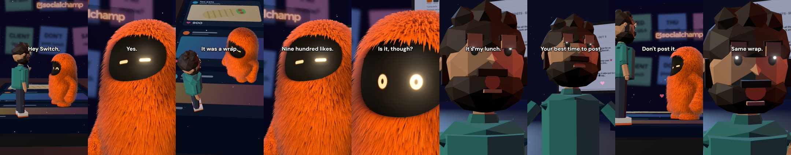

# character-reel-kit

**Make a short two-character comedy reel with Claude Code**: a mascot and a human in a 3D set, voiced as one acted
conversation (gasps, sighs, whispers, laughs), with word-synced captions, a beat-cut camera, music under the voice,
and scripted checks before anyone watches it.

You write the scene. The `/character-reel` skill walks Claude through the story, the voice direction, the ElevenLabs
take, the timing fixes, the render, the mix and the gates.

## The example reel (voices: elevenlabs.io)



**[Watch the example (60 s, 540x960, MP4, 4 MB)](media/example-ep01-540p.mp4)** ·
[full 1080x1920 version](https://github.com/SameerKhan/character-reel-kit/releases/latest) ·
[poster frame](media/example-poster.jpg)

*That's a wrap* (a dramatised scene; the people, posts and numbers in it are fictional): Leo, a social media manager, posted his lunch on a client's LinkedIn. Switch, the AI, tells him it
is doing numbers (900 likes, against 12 on the launch post), explains why it worked (it went out at the account's
best time to post), and Leo schedules tomorrow's launch for the same minute. He then goes to get lunch. Switch:
"Don't post it." Leo: "Already scheduled. Same wrap."

The reel is Social Champ's: its brand, the Switch mascot, the screen captures and the characters are not covered by
this repo's MIT licence (see [LICENSE](LICENSE)). **Audio: voices generated with [elevenlabs.io](https://elevenlabs.io)
(Eleven v3, default voices "Liam" and "Jessica")**. The example audio was made on ElevenLabs' free plan, which carries
no commercial licence: it is included only to demonstrate the kit and must not be reused, and any reel you publish for
a business needs audio generated on a paid ElevenLabs plan.

## Who Switch is

Switch is the AI assistant inside [Social Champ](https://www.socialchamp.com), the social media management
platform. In the reels it is the orange, furry mascot with glowing eyes. In the product it is a chat panel that is
already connected to your channels, your published posts, your analytics, your inbox and your approval queue. You
type a sentence and it does the job inside the product (drafting, rescheduling, approving, pausing an ad) instead of
handing you text to paste somewhere else.

What Switch does today:

- **Writes from your own posts.** Drafts are style-matched to what the account actually published: punctuation and
  capitalisation are measured from real posts and applied to the draft. Ask for three hooks (curiosity gap, bold
  claim, specific story) and it recommends one; ask for a six-slide carousel and it lays out the hook-to-CTA arc
  (generated slide artwork in your brand colours is in beta).
- **Answers "what's working" in the chat.** Best-performing posts and why, charts inline, and the best time to post
  from the account's own history (once it has at least five logged posts), not a generic chart. This is the one idea
  the example reel turns on.
- **Schedules and reschedules in one line.** "Move everything from Friday to next Monday." Bulk-schedules up to 50
  posts with a preview first, across LinkedIn, Instagram, X, Facebook, TikTok, Threads, Reddit, YouTube and
  Pinterest, and creates shareable calendar links for clients.
- **Triages the inbox.** Pulls unread comments and DMs from your connected channels and drafts friendly, apologetic
  or celebratory replies; empathetic, defusing and boundary-setting replies for harder situations are in beta.
- **Handles team approvals (beta).** Shows what is pending and who is waiting, approves or rejects with a note, and
  reminds approvers.
- **Runs paid campaigns on Google and Meta.** Launch, adjust and pause campaigns from the chat, with a typed
  confirmation before larger spends and one prompt that pauses every active campaign on your connected ad accounts.
- **Listens.** Recent brand mentions and competitors' top posts, plus keyword alerts created from the chat on
  Reddit, YouTube, LinkedIn, Bluesky, Facebook and Instagram (Facebook and LinkedIn alerts also need Pages picked in
  the Listening screen; listening depends on the plan).
- **Works with your own AI key.** Where the plan allows it, the account owner can connect their own Anthropic
  (Claude), OpenAI or Google (Gemini) API key. Social Champ charges nothing extra (you pay your AI provider directly), and the usage that runs
  on your key no longer counts against Switch's monthly limit.

Switch's own disclaimer, as shown in the app: *"Switch can get things wrong. Check anything before it goes out."*

The reels in this kit follow one rule taken from that list: each episode shows **one** capability, and it solves the
human's problem. Showing four capabilities in one reel was rejected as "too many features, the script gets lost".

## Why this exists

The example took thirteen versions. Open-source voices were rejected three times ("the tone doesn't change", "all
robotic", "the gasps sound fake"); ElevenLabs v3 dialogue was approved ("emotions are great"). Then the first
ElevenLabs render had a clipped last line and captions a second late at the end. The cause was not the renderer:
ElevenLabs' own timing data drifted by a second at one long sigh. The kit now re-anchors every line to where Whisper
hears it, keeps every breath between lines, and fails the build if captions drift. Every rule in the skill names the
failure that produced it. [Read the case study](plugins/character-reel/skills/character-reel/references/case-study.md).

## Quick start

1. Install the plugin in Claude Code:

   ```bash
   /plugin marketplace add SameerKhan/character-reel-kit
   /plugin install character-reel@character-reel-kit
   ```

2. Install the tools (Node 20+, ffmpeg, Python 3.11+, Chrome recommended), then render the example without any API
   key: **[walkthrough](plugins/character-reel/skills/character-reel/references/walkthrough.md)**.

3. Ask Claude for a reel: "/character-reel a reel where Leo double-booked a client launch and Switch finds the
   conflict". To voice new lines, set `ELEVENLABS_API_KEY` in your environment.

## What is inside

| Part | What it does |
|---|---|
| `SKILL.md` | the order of work and the hard rules |
| `references/` | story format (with measured reference numbers), voice direction and casting, timing, camera and captions, QA gates, case study, walkthrough |
| `scripts/make-reel.sh` | the whole pipeline with gates |
| `scripts/voice/` | `eleven_generate.py` (one dialogue call), `eleven_episode.py` (re-anchor, tile, caption timing), `check_sync.py` (caption gate), `textalign.py`, `music.py` |
| `scripts/engine/` | `desk.html` (shot planner, captions, facing cheats), `switch.js` (fur mascot), `man.js` (low-poly human), `set-desk.js`, `render.mjs` (headless Chrome, frame by frame), `mix.sh` (ducked music bed, -14 LUFS) |
| `examples/ep01-wrap/` | the approved example: script, tagged dialogue, voice ids and the ElevenLabs output, so it renders offline |

## Gates

Caption sync (every line within 0.25 s of what Whisper hears), no overlapping or zero-length caption words, every
line's audio contains all its words, -14 LUFS +- 0.5, true peak <= -1 dBTP, 20 to 62 s. The example passes all of
them; the kit reproduces the approved voice track byte for byte.

## Requirements

macOS or Linux, Node 20+, ffmpeg, Python 3.11+ (`numpy`, `soundfile`, `faster-whisper`), Chrome or Playwright's
Chromium. An ElevenLabs API key only for voicing new lines.

## Licence

Code: MIT, except the files and designs listed in [LICENSE](LICENSE): the Social Champ brand assets, the Switch and
Leo character designs (`switch.js`, `man.js`), the screen captures and the example reel belong to Social Champ, with a
limited permission to download and render them to try the kit. Example audio: generated with elevenlabs.io on the free
plan, for demonstration only.
